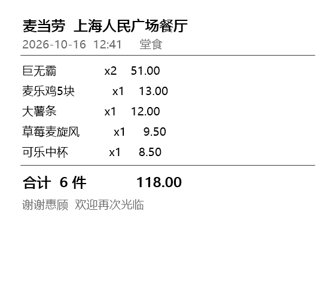

# McGenesis · 麦麦创世纪

```text
   __  __  ___  ___      ___ ___ ___ _  _  ___ ___ ___
  |  \/  |/ __||   \    / __| __/ __| \| |/ __|_ _/ __|
  | |\/| | (_ || |) |  | (_ | _|\__ \ .` |\__ \| |\__ \
  |_|  |_|\___||___/    \___|___|___/_|\_|___/___|___/
```

> **上传一张麦当劳账单，上帝会用上面的菜给你捏一只宠物。**
>
> 每次捏出来的都不一样。营养数据是真的，但翻车是上帝的。

## 它好玩在哪

它不是计算器，是**抽卡**。

- 你点一份巨无霸 → 捏人的时候真的会胖
- 你点太多麦乐鸡 → 它可能进化成「麦乐鸡侠」
- 上帝打个喷嚏 → 某项属性翻倍
- 酱包爆了 → 颜值 -12

最离谱的是：**同一张账单，跑三次，得到三只不同的宠物**。

## 先看效果

**上传截图**

```bash
python -m mcd_genesis hatch --image examples/receipt-sample.png
```



**识别 → 解析 → 捏人**

```text
  解析:
    ✓ 巨无霸            ×2  -> 巨无霸
    ✓ 麦乐鸡5块          ×1  -> 麦乐鸡5块
    ✓ 大薯条            ×1  -> 大薯条
    ✓ 草莓麦旋风          ×1  -> 草莓麦旋风
    ✓ 可乐中杯           ×1  -> 可乐中杯

  ┌────────────────────────────────────────────────────────────┐
  │  SR   高血压猫                                             │
  ├────────────────────────────────────────────────────────────┤
  │    /\___/\     颜值   █░░░░░░░░░░░ 6.9                     │
  │   ( @  @  )    才智   ███░░░░░░░░░ 22.0                    │
  │   (  ~~~  )    体质   ████░░░░░░░░ 40.5                    │
  │    (_____)     血压   ██████████░░ 190.3                   │
  │                 体重   2,496 g                             │
  │                 气运   ███████░░░░░ 57.0  ← 隐藏属性       │
  ├────────────────────────────────────────────────────────────┤
  │ 血统：混血麦麦                                             │
  │ 词条：酱渍 / 大难不死                                      │
  │ 翻车记录：2 次 — 酱包爆了、整个托盘翻了                    │
  └────────────────────────────────────────────────────────────┘
```

**同一张账单，捏三次**

```text
  【第 1 只】种子 885084664
     → SR  麦门圣猫（翻车 1 次）

  【第 2 只】种子 220673509
     → SSR 麦门圣猫（翻车 2 次）

  【第 3 只】种子 806916189
     → R   麦门圣猫（全程零失误）
```

（完整输出见 `实测记录.txt`）

## 10 秒上手

```bash
# 方式 1：上传麦当劳账单截图（Windows 自带 OCR，无需额外安装）
python -m mcd_genesis hatch --image 你的账单.png

# 方式 2：直接打字
python -m mcd_genesis hatch "巨无霸 x2, 麦乐鸡5块, 大薯条"

# 方式 3：看内置演示
python demo.py

# 方式 4：连麦当劳 MCP 实时数据
python demo.py --live        # 需要 MCD_MCP_TOKEN 环境变量
```

## 为什么每次都不一样

三个不确定性来源：

1. **基因表达随机浮动**：每道菜的营养贡献会乘 `0.65 ~ 1.35` 的系数
2. **翻车事件随机触发**：每条菜有 26% 概率触发「托盘翻了」「酱包爆了」等事件
3. **气运**：出厂设置里藏了一个 `1 ~ 100` 的纯随机隐藏属性

所以：

```text
同样的 118 元账单，
一次捏出高血压猫，
一次捏出麦门圣猫，
一次上帝手抖三次，直接 SP。
```

加 `--seed <数字>` 可以复现某一只。

## 基因映射表（真实 MCP 数据）

| 营养字段 | 属性影响 | 备注 |
|---|---|---|
| 热量 kcal | 体重 + 体质 | `7700 kcal ≈ 1 kg 脂肪` |
| 蛋白质 | 体质 + 才智 | 健身的人懂 |
| 脂肪 | 血压 + / 颜值 - | 吃多了脸会垮 |
| 碳水 | 颜值 + / 才智 + | 糖分让人快乐 |
| 钠 | 血压 ++ | 麦当劳的钠，懂的都懂 |
| 钙 | 才智 + 体质 + | 骨骼决定上线 |

所有营养数据来自麦当劳官方 MCP：`list-nutrition-foods`（158 个在售餐品真实返回值）。

## 10 种出生结果

形态按属性组合 + 翻车记录 + 血统判定：

| 形态 | 触发条件 |
|---|---|
| 高血压猫 | 血压 ≥ 190 mmHg |
| 巨无霸兽 | 体重 ≥ 6000 g |
| 糖分恶魔 | 甜品占比 ≥ 30% |
| 碳酸诗人 | 饮料占比 ≥ 40% |
| 薯条精 | 薯条占比 ≥ 30% |
| 麦乐鸡侠 | 鸡类占比 ≥ 40% |
| 麦门圣猫 | 颜值 ≥ 18 |
| 麦香哲学家 | 才智 ≥ 26 |
| 天弃之子 | 翻车 3 次，或翻车 2 次且气运 < 20 |
| 普通麦麦 | 以上皆不满足 |

稀有度：N / R / SR / SSR / UR / SP（按综合评分 + 气运 + 翻车加成）。

## OCR 说明

- 仅 Windows 可用（调用系统内置 `Windows.Media.Ocr`）
- 支持语言包：简体中文（`zh-Hans-CN`）
- 识别结果会按顺序与菜品对齐，OCR 常见的字间空格、全角小数点已做兼容
- 识别失败会自动提示改用文本输入

检测 OCR 可用性：

```bash
python -m mcd_genesis ocr
```

## 项目结构

```text
mcd-genesis/
├── mcd_genesis/       核心模块
│   ├── foods.py       158 个真实餐品饲料库
│   ├── genes.py       基因映射（营养 → 属性）
│   ├── accident.py    翻车事件库
│   ├── forms.py       形态 / 稀有度 / ASCII 立绘
│   ├── forge.py       捏人流程 + 出生公告面板
│   ├── receipt.py     账单解析（OCR / 手输）
│   ├── ocr.py         Windows 内置 OCR 封装
│   └── cli.py         命令行入口
├── data/foods.json    麦当劳 MCP 营养快照
├── examples/          示例账单图片生成脚本 + 样张
├── tests/             单元测试
├── demo.py            一键演示
└── 实测记录.txt        真实运行输出
```

## 技术栈

- **纯标准库**：Python 3.8+，零 pip 依赖
- **数据**：麦当劳官方 MCP Server（`list-nutrition-foods`）
- **OCR**：Windows 10/11 自带引擎（`Windows.Media.Ocr`）
- **测试**：unittest，12 项用例

## 命令总览

```bash
python -m mcd_genesis hatch --image 账单.png      # 截图识别
python -m mcd_genesis hatch "巨无霸 x2"           # 文本输入
python -m mcd_genesis hatch --seed 7              # 固定种子复现
python -m mcd_genesis menu --limit 20             # 查看饲料库
python -m mcd_genesis forms                     # 查看所有形态
python -m mcd_genesis ocr                       # 检测 OCR 可用性
python -m unittest discover -s tests            # 跑测试
```

## 参赛声明

`CONTEST_DECLARATION.md` 为官方参赛声明，原文未改动。

真实 MCP Token 仅通过环境变量 `MCD_MCP_TOKEN` 传入，仓库内不出现任何 Token 或 PAT。

## 许可证

MIT

---

**给 GitHub  passerby 的一句话**：如果你也点过麦当劳，把你的账单截图传给它，看看你捏出来的是麦门圣猫还是高血压猫。
